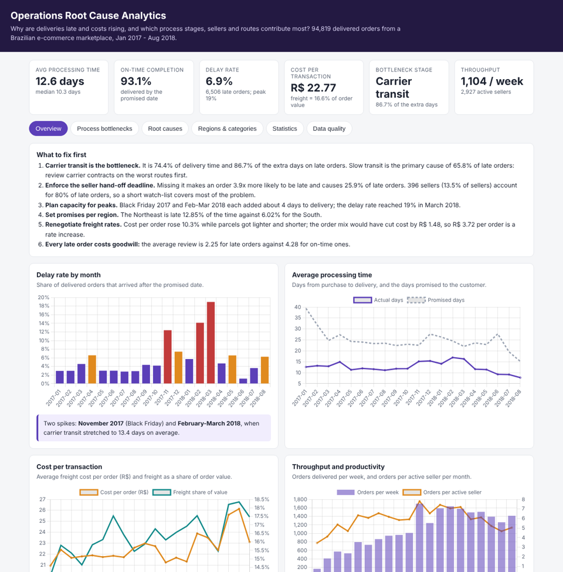
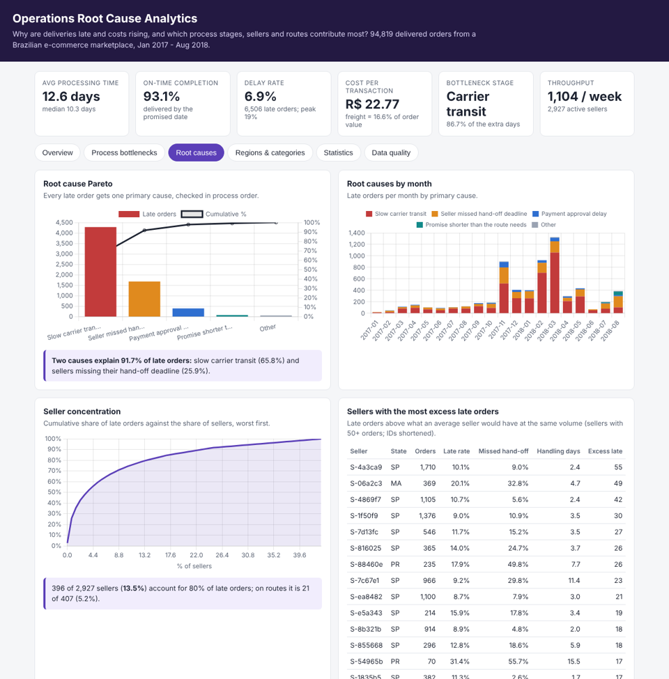
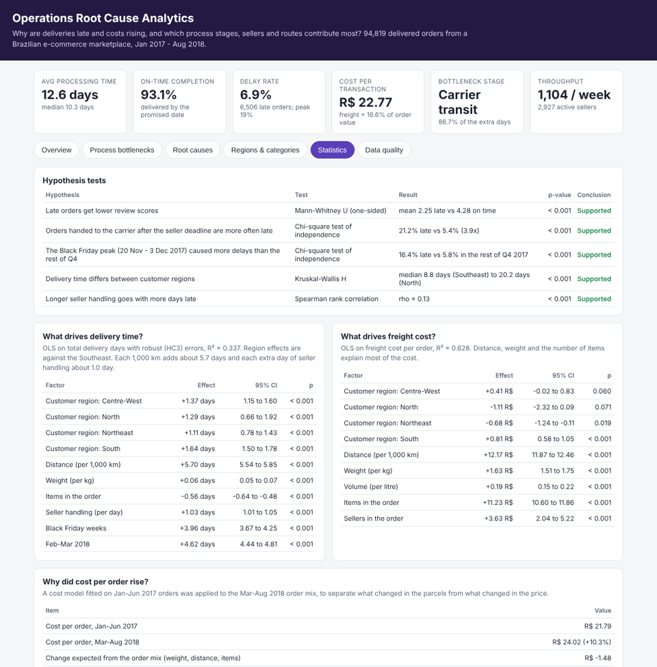
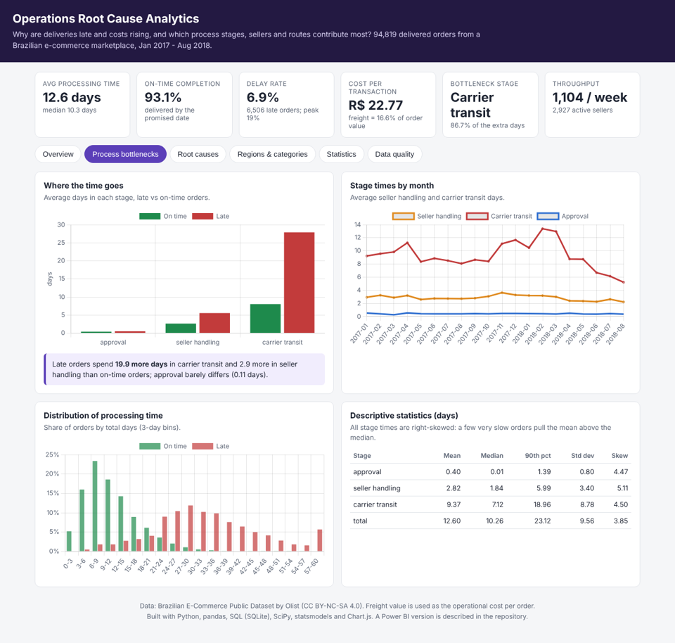

# Operational Excellence & Root Cause Analytics


**Business problem:** why are operational costs rising, and which process stages, sellers, routes and regions contribute most to delays and poor performance?

This project explains operational problems rather than predicting demand. It follows 94,819 real marketplace orders through three process stages and finds where the delays and costs come from.

**Live dashboard:** https://s-harshni.github.io/Operational-Excellence-Root-Cause-Analytics/



## Key findings

| Question | Answer |
| --- | --- |
| How is the operation performing? | Orders take **12.6 days** on average (median 10.3); **93.1%** arrive by the promised date; cost per transaction is **R$ 22.77** (16.6% of order value); throughput is about 1,100 orders a week across 2,927 sellers. |
| Which stage is the bottleneck? | **Carrier transit**: 74.4% of the time, and **86.7% of the extra days** on late orders (late orders spend 19.9 more days in transit, 2.9 more in seller handling, 0.1 more in approval). |
| What causes late orders? | Pareto of primary causes: **slow carrier transit 65.8%**, **seller missed the hand-off deadline 25.9%**, payment approval delay 6.1%. Two causes explain **91.7%** of late orders. |
| Is the problem spread out? | No. **396 of 2,927 sellers (13.5%)** account for 80% of late orders, and **21 of 407 routes (5.2%)**. São Paulo → Rio de Janeiro alone has 1,149 late orders: it is 441 km but late 14.3% of the time with 13 days of transit, while São Paulo → Minas Gerais (495 km) is late 5.4% with 9 days. |
| When did performance get worse? | **Black Friday 2017** (16.4% late vs 5.8% in the rest of Q4) and **Feb–Mar 2018**, when transit stretched to 13 days and the delay rate hit **19%**. |
| Why are costs rising? | Cost per order rose **10.3%** (R$ 21.79 → R$ 24.02) while parcels got lighter (2.56 → 2.29 kg) and travelled less (634 → 571 km). A 2017 cost model says the mix should have **cut** cost by R$ 1.48, so **R$ 3.72 per order is a rate increase**, not a change in what was shipped. |
| Does it matter to customers? | Late orders average a **2.25** review against **4.28** for on-time orders. |

### What to fix first

1. **Carrier transit on the worst routes**, starting with São Paulo → Rio de Janeiro and the Northeast (late 12.9% of the time, twice the South).
2. **Seller hand-off deadline**: missing it makes an order **3.9× more likely** to be late; a watch-list of 396 sellers covers 80% of late orders.
3. **Peak capacity** for Black Friday and the first quarter, each of which added about 4 days to delivery.
4. **Freight rates**: renegotiate, since rising cost is price, not volume or distance.

## Data

[Brazilian E-Commerce Public Dataset by Olist](https://www.kaggle.com/datasets/olistbr/brazilian-ecommerce) (CC BY-NC-SA 4.0): 99,441 real orders from 2016–2018 across 9 tables (orders, items, sellers, customers, products, reviews, payments, category names, geolocation). `python run.py` downloads them into `data/raw/`. Freight value is used as the operational cost per transaction; sellers play the role of teams and Brazilian states and regions the role of locations.

### Process stages

```
purchase ──► approval ──► seller hands parcel to carrier ──► carrier delivers ──► review
             (payment)    (seller handling, has a deadline)  (carrier transit)
```

## Method

| Step | What it does | Code |
| --- | --- | --- |
| **Cleaning** | Joins 9 tables into one row per order; times each stage; removes 559 duplicate reviews (keeps the latest), 1,350 orders with a carrier pick-up before approval, 23 delivered before pick-up, 4 impossible distances from bad coordinates; keeps Jan 2017–Aug 2018 (complete months) | [`data.py`](src/opsrc/data.py) |
| **SQL** | Monthly KPIs, stage times late vs on time, customer states, categories, sellers missing hand-offs, worst routes | [`sql/`](sql) |
| **KPIs** | Processing time, on-time completion, delay rate, cost per transaction, freight share, throughput, orders per active seller | [`analysis.py`](src/opsrc/analysis.py) |
| **Bottlenecks** | Share of time per stage, extra days of late vs on-time orders, descriptive statistics and skew | [`analysis.py`](src/opsrc/analysis.py) |
| **Root causes** | One primary cause per late order, checked in process order against the typical time of its seller-state → customer-state route; Pareto by cause, seller, route, category and state | [`analysis.py`](src/opsrc/analysis.py) |
| **Statistics** | Hypothesis tests, Spearman correlations, two OLS regressions with robust (HC3) errors, a cost decomposition | [`analysis.py`](src/opsrc/analysis.py) |

### Root-cause rules

| Cause | Rule |
| --- | --- |
| Payment approval delay | approval took more than 2 days |
| Seller missed hand-off deadline | parcel reached the carrier after the seller's shipping limit |
| Slow carrier transit | transit ≥ 1.5× and 3+ days longer than typical for that route |
| Promise shorter than the route needs | promised days below the route's typical delivery time |
| Other | none of the above |



### Hypothesis tests

| Hypothesis | Test | Result | p |
| --- | --- | --- | ---: |
| Late orders get lower review scores | Mann-Whitney U | 2.25 vs 4.28 | < 0.001 |
| Missing the seller hand-off deadline makes orders late | Chi-square | 21.2% vs 5.4% late (3.9×) | < 0.001 |
| Black Friday caused more delays than the rest of Q4 2017 | Chi-square | 16.4% vs 5.8% | < 0.001 |
| Delivery time differs between regions | Kruskal-Wallis | median 8.8 days (Southeast) to 20.2 (North) | < 0.001 |
| Longer seller handling goes with more days late | Spearman | ρ = 0.13 | < 0.001 |

### Regression: what drives delivery time? (OLS, R² = 0.34)

| Factor | Effect on total days | 95% CI |
| --- | ---: | ---: |
| Distance, per 1,000 km | +5.70 | 5.54 to 5.85 |
| Seller handling, per day | +1.03 | 1.01 to 1.05 |
| Black Friday weeks | +3.96 | 3.67 to 4.25 |
| Feb–Mar 2018 | +4.62 | 4.44 to 4.81 |
| South / Centre-West / North / Northeast vs Southeast | +1.1 to +1.6 | |

### Regression: what drives freight cost? (OLS, R² = 0.63)

| Factor | Effect on cost per order |
| --- | ---: |
| Distance, per 1,000 km | +R$ 12.17 |
| Weight, per kg | +R$ 1.63 |
| Each extra item | +R$ 11.23 |
| Each extra seller in the order | +R$ 3.63 |



## Dashboard

| KPI | Purpose |
| --- | --- |
| Average processing time | Operational speed |
| On-time completion rate | Service performance |
| Cost per transaction | Efficiency |
| Delay rate | Operational problems |
| Process-stage bottlenecks | Where delays occur |
| Root cause breakdown | Which improvements to prioritise |

The [live dashboard](https://s-harshni.github.io/Operational-Excellence-Root-Cause-Analytics/) has six pages: overview and recommendations, process bottlenecks, root causes, regions and categories, statistics, and the data-cleaning log.

**Power BI:** `powerbi/data/` holds the model (`fact_orders` with 94,819 orders, `dim_seller`, monthly KPIs, Pareto, tests and regression results), [`powerbi/measures.dax`](powerbi/measures.dax) the DAX measures (`fact_orders.csv` is 14 MB, so it is not committed: `python run.py` writes it), and [`powerbi/POWERBI_GUIDE.md`](powerbi/POWERBI_GUIDE.md) the report pages.



## Run it

```bash
python -m venv .venv && source .venv/bin/activate
pip install -r requirements.txt
python run.py                       # downloads the data, writes results/, docs/data.json and powerbi/data/
pytest -q                           # 9 tests on a small synthetic data set
python -m http.server -d docs 8000  # dashboard at http://localhost:8000
```

## Tests

The 9 tests check the cleaning counts (duplicate reviews, impossible stage dates, cancelled orders), that the three stages add up to the total time and are never negative, that invalid orders are excluded, the distance formula (São Paulo to Rio ≈ 360 km), that a seller who misses the hand-off deadline is flagged and gets that root cause, the Pareto and concentration maths, that KPIs are consistent, and that every SQL query runs.

## Limitations

- Freight value is what the customer paid for shipping; it stands in for the operation's logistics cost.
- Root causes are rule-based and assign one primary cause; some late orders have several.
- The regressions show association, not proof of cause; the delivery-time model explains about a third of the variation.
- Seller IDs are shortened on the dashboard; the source data is already anonymised.

## Author

**S Harshni** · [Portfolio](https://s-harshni.github.io/S-Harshni/) · [LinkedIn](https://www.linkedin.com/in/ks-harshni/) · [GitHub](https://github.com/S-Harshni)
